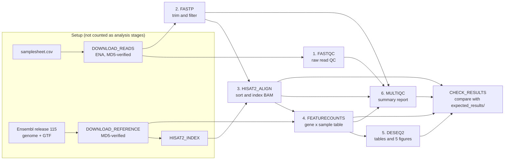
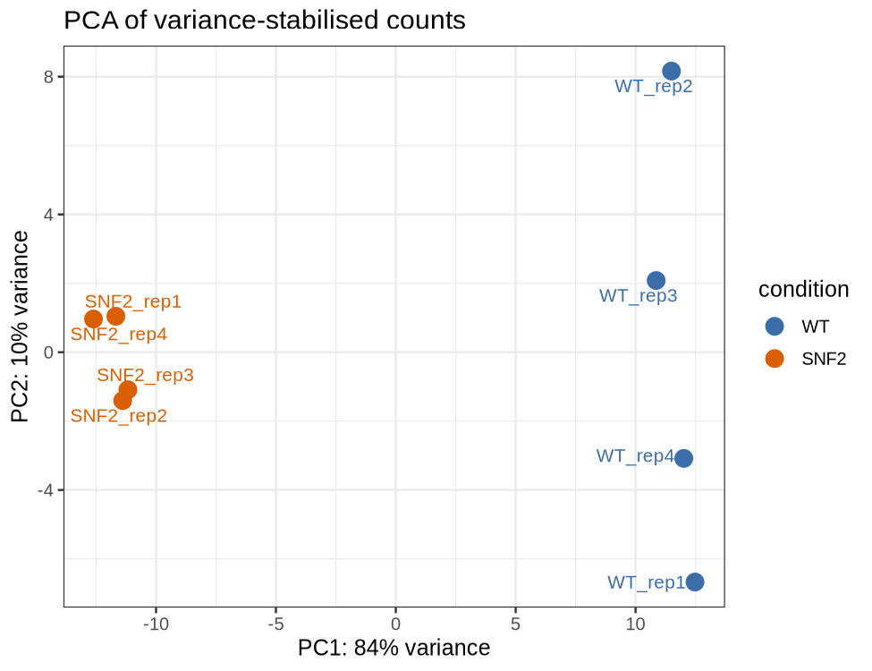
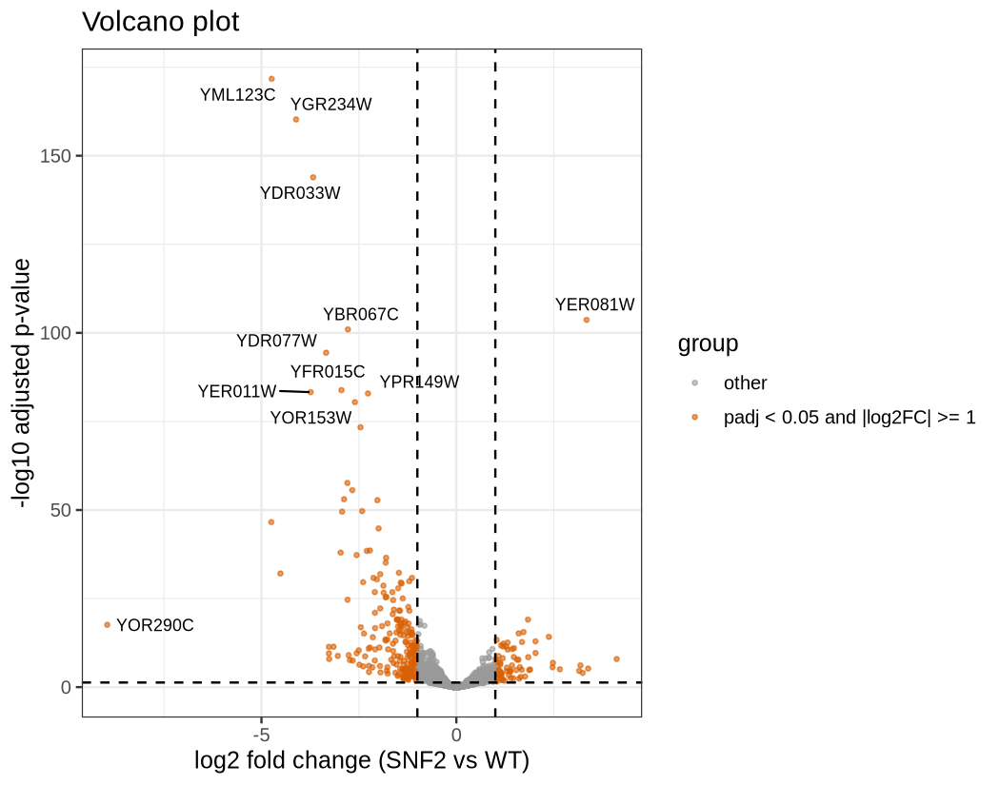

# Yeast *snf2* RNA-seq: a reproducible Nextflow pipeline

Differential gene expression in *Saccharomyces cerevisiae*: a *snf2* knockout versus wild type, from public sequencing reads to figures, in one command.

BIOF 501A: Special topics in bioinformatics · Term project · Tran Anh Thu Phung

```bash
NXF_VER=26.10.6 nextflow run main.nf -profile conda
```

Prerequisites (Java, Nextflow, conda) and full instructions are in [section 6](#6-how-to-run-the-pipeline).

## Contents

1. [Project background](#1-project-background)
2. [Rationale for the pipeline's design](#2-rationale-for-the-pipelines-design)
3. [Pipeline stages and DAG](#3-pipeline-stages-and-dag)
4. [Data](#4-data)
5. [Dependencies](#5-dependencies)
6. [How to run the pipeline](#6-how-to-run-the-pipeline)
7. [Directory structure](#7-directory-structure)
8. [Results of the default run](#8-results-of-the-default-run)
9. [Limitations](#9-limitations)
10. [References](#10-references)

---

## 1. Project background

SNF2 is the catalytic ATPase subunit of the SWI/SNF chromatin-remodelling complex. SWI/SNF slides and ejects nucleosomes so that regulatory proteins can reach DNA, which helps switch many genes on. The complex is conserved from yeast to humans, where the SNF2 homologues SMARCA4 (BRG1) and SMARCA2 belong to a family of remodelling genes that are frequently mutated in cancer. Deleting *SNF2* in yeast is therefore a simple system for asking which genes depend on a chromatin remodeller.

**Biological question:** which genes change expression when *SNF2* is deleted in *S. cerevisiae*?

**Computational goal:** answer this with a workflow that anyone can rerun and obtain the same numbers: pinned software versions, verified downloads, automatic data retrieval, and a built-in comparison against stored expected results.

The data come from a published, highly replicated experiment (Gierliński *et al.* 2015; Schurch *et al.* 2016). This project uses a small subset: **4 wild-type and 4 Δsnf2 biological replicates**, chosen so the pipeline downloads under 0.7 GB and runs in minutes on a laptop.

## 2. Rationale for the pipeline's design

**Why a workflow manager (Nextflow).** A plain shell script has to be rewritten for each machine, cannot resume after a failure, and runs samples one at a time. Nextflow runs one task per sample in parallel, gives each task its own folder, records what ran (`results/pipeline_info/`), and restarts from the failed step with `-resume`.

**Why conda inside Nextflow (not Docker).** Each process declares its own pinned conda environment (`envs/*.yml`), and Nextflow builds it automatically. Conda packages for every tool exist natively for Linux amd64, Linux arm64, macOS Intel and macOS Apple silicon (checked by solving each environment for all four platforms). Most BioContainers images are amd64-only, so on Apple silicon they would run through slow emulation, and Docker needs a root daemon that shared clusters often forbid.

**Pinned and verified inputs.** Every tool version is pinned. Reads come from ENA by explicit URL with an MD5 checksum; the Ensembl reference is a fixed release (115) with MD5 checksums recorded in `main.nf`. A corrupt or changed file fails loudly and is retried instead of silently changing results. Downloads retry automatically and fall back from `https://` to `ftp://`.

**Choice of tools.**

| Step | Choice | Reason |
|---|---|---|
| Alignment | HISAT2 | Small genome (12 Mb), one-command index, low memory (peak 0.6 GB), uses known splice sites from the annotation |
| Counting | featureCounts, exons grouped by `gene_id` | Standard gene-level counts; multi-mapping reads are excluded (default), as usual for differential expression |
| Statistics | DESeq2 (design `~ condition`, WT as reference) | Standard for count data; handles differing sequencing depth |
| Fold-change display | apeglm shrinkage | Pulls unreliable large fold changes from low-count genes toward zero in the plots; unshrunken values are also saved |
| Significance | adjusted p < 0.05 and, for "strong" changes, \|log2 fold change\| ≥ 1 | Conventional thresholds |
| Gene filter | ≥ 10 reads in ≥ 4 samples | Removes unexpressed genes; 4 is the size of the smaller group |

**Library strandedness was measured, not assumed.** featureCounts was run three times (`-s 0`, `-s 1`, `-s 2`). Under `-s 0`, 61–68% of reads were assigned to genes; under `-s 1` and `-s 2` only 33–39% were. That "about half" pattern means the library is unstranded, so the default is `--strandedness 0`. The three summaries are kept in `metadata/strandedness_test_s*.summary`.

**Quality-control decisions.** In all eight samples FastQC flags *per-base sequence content* (red), *per-tile sequence quality* (red) and *sequence duplication levels* (orange), while *per-base sequence quality* is green. These are expected for random-primed RNA-seq on an older HiSeq instrument: the first bases of reads are biased by random priming, and highly expressed genes legitimately produce many identical reads. The samples behave alike (Q30 ≈ 91%, fastp keeps 99.6–99.8% of reads, adapter dimers ≤ 0.22%), so no read was hard-trimmed beyond adapters and **duplicates were deliberately not removed**, because removal would erase real expression differences.

**Why 4 vs 4, one lane.** Four replicates per group keep the download at 693 MB and the run short; the study authors recommend at least six replicates for small effects (Schurch *et al.* 2016), so the number of changed genes found here is probably an underestimate. Using the same sequencing lane (lane 1) for every sample prevents a lane difference from being mistaken for a genotype effect.

**Built-in reproducibility check.** The last step compares the run with `expected_results/`. Integer counts must reproduce, and the statistical output is allowed a tiny tolerance, because decimals from DESeq2 can differ in the last digits between CPU architectures. Two independent runs on one machine produced byte-identical count, DESeq2 and summary tables.

## 3. Pipeline stages and DAG



Nextflow also writes its own graph of the executed run to `results/pipeline_info/dag.mmd` (a copy is in `docs/dag.mmd`).

| # | Process | Tool (version) | Input → output | Key settings |
|---|---|---|---|---|
| setup | `DOWNLOAD_READS` | curl, md5sum | URL + MD5 → FASTQ | 3 parallel downloads, retries, https→ftp fallback |
| setup | `DOWNLOAD_REFERENCE` | curl, md5sum | URL + MD5 → genome FASTA, GTF | same as above |
| setup | `HISAT2_INDEX` | HISAT2 2.2.3 | FASTA + GTF → index | known exons and splice sites used |
| 1 | `FASTQC` | FastQC 0.13.0 | raw reads → HTML + zip report | one task per sample |
| 2 | `FASTP` | fastp 1.4.0 | raw reads → trimmed reads, HTML + JSON | TruSeq adapter `AGATCGGAAGAGC`, minimum length 25 |
| 3 | `HISAT2_ALIGN` | HISAT2 2.2.3, samtools 1.25 | trimmed reads → sorted, indexed BAM; alignment log; `flagstat` | single-end, unstranded alignment |
| 4 | `FEATURECOUNTS` | Subread 2.1.1 | all BAMs + GTF → gene × sample count table | `-t exon -g gene_id -s 0` |
| 5 | `DESEQ2` | R 4.5.3, DESeq2 1.50.2, apeglm 1.32.0 | count table + samplesheet → results tables, 5 PNG figures | WT vs SNF2, thresholds above |
| 6 | `MULTIQC` | MultiQC 1.35 | all logs → one HTML report | custom title, sample-name cleaning |
| check | `CHECK_RESULTS` | Python 3.12.15 (standard library) | run outputs + `expected_results/` → PASS/FAIL report | tolerances described in section 2 |

The analysis has six consecutive stages (the three setup processes are not counted).

## 4. Data

**Sequencing reads.** Public data from ENA project **PRJEB5348** (study ERP004763): a highly replicated RNA-seq experiment on wild-type *S. cerevisiae* (strain BY4741) and an isogenic *snf2* deletion, with 48 biological replicates per condition, each sequenced in 7 lanes (technical replicates). Reads are single-end, 51 bp, Illumina HiSeq 2000. The ENA record's sample names do not identify biological replicates, so the author-provided mapping (FigShare, doi:10.6084/m9.figshare.1416210) was used to link runs to replicates and lanes, and the authors' list of ten poor-quality replicates (github.com/bartongroup/profDGE48) was consulted.

**Subset used.** Lane 1 of the four lowest-numbered replicates of each condition (none are on the exclusion list):

| Sample | Condition | ENA run | Reads | Download size |
|---|---|---|---|---|
| SNF2_rep1 | SNF2 | ERR458500 | 1,885,330 | 102.2 MB |
| SNF2_rep2 | SNF2 | ERR458507 | 1,594,160 | 86.4 MB |
| SNF2_rep3 | SNF2 | ERR458514 | 1,594,695 | 86.5 MB |
| SNF2_rep4 | SNF2 | ERR458521 | 1,977,253 | 107.0 MB |
| WT_rep1 | WT | ERR458493 | 1,093,957 | 59.5 MB |
| WT_rep2 | WT | ERR458878 | 1,467,569 | 79.8 MB |
| WT_rep3 | WT | ERR458885 | 1,228,207 | 66.8 MB |
| WT_rep4 | WT | ERR458892 | 1,926,855 | 104.5 MB |

Total download: 692.7 MB. `samplesheet.csv` lists each sample's URL and MD5; the pipeline downloads the data itself, so no sequencing data is stored in this repository.

**Reference.** *S. cerevisiae* assembly R64-1-1 from **Ensembl release 115**: the soft-unmasked top-level genome FASTA (`Saccharomyces_cerevisiae.R64-1-1.dna.toplevel.fa.gz`, 17 sequences: chromosomes I–XVI and mitochondrion) and the gene annotation (`Saccharomyces_cerevisiae.R64-1-1.115.gtf.gz`). Release directories are permanent, and their MD5 checksums are set in `main.nf`. The count table has 7,127 genes. The ENA description of the experiment also mentions ERCC spike-in controls; these do not align to the yeast genome.

**Provenance files** (`metadata/`): the ENA run table, the author-provided run-to-replicate mapping, the exclusion list, the selection tables (`selected_runs_4v4.tsv`, plus the earlier 6 vs 6 selection), and the strandedness test summaries.

## 5. Dependencies

**Core (install yourself):**

| Software | Version | Purpose |
|---|---|---|
| Java | 17 or newer (up to 26) | needed by Nextflow |
| Nextflow | **26.10.6** (tested; 26.04 or newer required) | workflow engine |
| conda | any recent conda or Miniforge (with `conda` on the PATH) | Nextflow builds each tool environment with it |
| git, curl | any | clone the repository, install Nextflow |

**Pipeline tools (installed automatically by Nextflow from `envs/`):**

| Environment file | Packages (exact versions) |
|---|---|
| `download.yml` | curl 8.23.0, coreutils 9.12 |
| `align.yml` | hisat2 2.2.3, samtools 1.25 |
| `qc.yml` | fastqc 0.13.0, fastp 1.4.0 |
| `count.yml` | subread 2.1.1 (featureCounts) |
| `deseq2.yml` | r-base 4.5.3, bioconductor-deseq2 1.50.2, bioconductor-apeglm 1.32.0, r-ggplot2 4.0.4, r-pheatmap 1.0.13, r-ggrepel 0.9.8, r-rcolorbrewer 1.1_3 |
| `multiqc.yml` | multiqc 1.35 |
| `check.yml` | python 3.12.15 |

All environments use the `conda-forge` and `bioconda` channels (with `nodefaults`). They resolve for linux-64, linux-aarch64, osx-64 and osx-arm64.

## 6. How to run the pipeline

**Requirements:** Linux or macOS on amd64 or arm64, internet access, about 10 GB of free disk (measured: environments 3.6 GB at measurement time, conda's package cache 4.2 GB, results 0.65 GB), and 6 CPU cores recommended. Windows users must use WSL2 (`wsl --install` in an administrator PowerShell, then work inside the Ubuntu terminal, in the Linux home folder, not under `/mnt/c`).

### 6.1 Install the core dependencies

Ubuntu/Debian (and Ubuntu on WSL2):

```bash
sudo apt update
sudo apt install -y openjdk-17-jre-headless curl git

# Nextflow
curl -s https://get.nextflow.io | bash
mkdir -p ~/.local/bin && mv nextflow ~/.local/bin/
echo 'export PATH="$HOME/.local/bin:$PATH"' >> ~/.bashrc

# Miniforge (provides conda)
curl -L -O "https://github.com/conda-forge/miniforge/releases/latest/download/Miniforge3-$(uname)-$(uname -m).sh"
bash Miniforge3-$(uname)-$(uname -m).sh -b -p $HOME/miniforge3
$HOME/miniforge3/bin/conda init bash
```

Close and reopen the terminal, then check:

```bash
java -version        # 17 or newer
nextflow -version
conda --version
```

macOS: install a Java 17+ JDK (for example from https://adoptium.net), then run the same `curl` commands for Nextflow and Miniforge (the Miniforge file name adapts through `uname`) and use `conda init zsh`. This route has not been tested on a Mac.

### 6.2 Get the pipeline and run it

```bash
git clone https://github.com/Wendy1907/yeast-snf2-rnaseq.git
cd yeast-snf2-rnaseq
NXF_VER=26.10.6 nextflow run main.nf -profile conda
```

`NXF_VER` makes Nextflow use exactly the tested version (it downloads it on first use). The first run downloads the data and builds seven conda environments, so it takes longer than later runs. Nothing else needs to be configured: no manual downloads, no `conda activate`.

To mimic a 6-core machine for timing, add `-c conf/limit_6cores.config`. To restart after an interruption, add `-resume`.

### 6.3 What to expect

- **Time:** measured on a clean clone, capped at 6 CPUs (Ubuntu on WSL2, amd64, fast connection): **7 min 8 s** for everything, including downloads (13 s to 3 min 46 s per file) and building the environments. The analysis stages together take about a minute. A slower connection mostly lengthens the downloads.
- **Memory:** the largest task (fastp) peaked at 1.1 GB.
- **The last output** is the reproducibility check printed in the terminal; a successful run ends with `OVERALL: PASS`. The report showed in `results/check_report.txt`:

```
Reproducibility check against expected_results/
  [PASS] Gene count matrix: identical (7127 genes x 8 samples)
  [PASS] HISAT2 alignment rates: 8/8 samples within 0.05 percentage points
  [PASS] DESeq2 results: 5454 genes compared, all values within tolerance
  [PASS] Figures and MultiQC report: all 6 files present
OVERALL: PASS
```

### 6.4 Outputs (`results/`)

| Folder / file | Contents |
|---|---|
| `multiqc/multiqc_report.html` | one summary of all QC and alignment results (open this first) |
| `deseq2/figures/` | `pca.png`, `sample_distance_heatmap.png`, `ma_plot.png`, `volcano.png`, `top_genes_heatmap.png` |
| `deseq2/` | `deseq2_results.csv` (all tested genes), `normalized_counts.csv`, `deseq2_summary.txt`, `deseq2_sessioninfo.txt` (R and package versions) |
| `counts/` | `gene_counts.tsv` (gene × sample), `counts.txt.summary` |
| `alignments/` | sorted, indexed BAM files (can be opened in a genome browser such as IGV) |
| `alignment_logs/` | HISAT2 logs and `samtools flagstat` per sample |
| `fastqc/`, `fastp/` | per-sample QC reports |
| `check_report.txt` | the PASS/FAIL comparison with `expected_results/` |
| `pipeline_info/` | `report.html`, `timeline.html`, `trace.txt`, `dag.mmd` for this run |

### 6.5 Options and troubleshooting

| Option | Meaning |
|---|---|
| `--samplesheet <csv>` | use another sample table (columns: `sample, condition, replicate, run_accession, fastq_md5, fastq_url`; conditions must be `WT` and `SNF2`). The final check will report FAIL, because it expects the default samples. |
| `--strandedness 0/1/2` | library strandedness for counting (default 0, unstranded) |
| `-resume` | reuse finished tasks |

- **A download fails or is slow.** ENA occasionally returns temporary errors; the pipeline retries automatically. If it still stops, rerun the same command with `-resume`.
- **Environment creation seems stuck.** The R environment is large and can take several minutes. The timeout is 60 minutes.
- **"Nextflow version" error.** Use `NXF_VER=26.10.6` as shown.
- **Free disk space.** `work/` (and the conda cache) can be deleted after the run: `rm -rf work .nextflow*`.
- **Start completely fresh.** `rm -rf work results .nextflow*`.

## 7. Directory structure

```
yeast-snf2-rnaseq/
├── README.md                  this file
├── main.nf                    the workflow: parameters, stages, published outputs
├── nextflow.config            resources, conda profile, run records
├── samplesheet.csv            the 8 samples: condition, ENA URL, MD5
├── assets/
│   └── multiqc_config.yaml    MultiQC title and sample-name cleaning
├── bin/
│   ├── deseq2.R               differential expression and figures
│   └── check_results.py       comparison with expected_results/
├── conf/
│   └── limit_6cores.config    optional: cap the run at 6 CPUs for timing
├── docs/
│   └── dag.mmd                Nextflow-generated graph of a run
├── envs/                      pinned conda environments (one per tool group)
│   ├── download.yml  align.yml  qc.yml  count.yml
│   └── deseq2.yml  multiqc.yml  check.yml
├── expected_results/          reference outputs of a clean run (see its README)
│   ├── alignment_logs/  counts/  deseq2/ (with figures/)
│   └── README.md
├── metadata/                  provenance: ENA table, run-to-replicate mapping,
│                              exclusion list, sample selection, strandedness tests
├── modules/                   one Nextflow process per file
│   ├── download.nf  fastqc.nf  fastp.nf  hisat2_index.nf  hisat2_align.nf
│   └── featurecounts.nf  deseq2.nf  multiqc.nf  check_results.nf
│
├── work/                      generated: task folders and conda environments
├── results/                   generated: all outputs (section 6.4)
└── .nextflow*                 generated: Nextflow logs and cache
```

The generated items (`work/`, `results/`, `.nextflow*`) are excluded from git.

## 8. Results of the default run





- **Alignment:** 96.6–98.0% of reads aligned in every sample.
- **Counting:** 7,127 genes; 61–68% of reads were assigned to genes (unstranded counting).
- **Sample structure (PCA):** PC1 explains 84% of the variance and separates all four knockout samples from all four wild-type samples; PC2 (10%) mainly spreads the wild-type replicates. No sample is an outlier.
- **Differential expression:** 5,454 genes passed the expression filter; **1,318 are significant** (adjusted p < 0.05: 511 higher, 807 lower in the knockout), of which **280 change at least two-fold** (71 higher, 209 lower). Downregulation dominates, consistent with SWI/SNF's role in activating genes.
- **Built-in biological control:** *SNF2* itself (YOR290C) is essentially absent in the knockout (0–1 reads against 148–250 in wild type; log2 fold change −9.17, adjusted p = 2.6 × 10⁻¹⁸), confirming the genotype at the RNA level.

All figures and tables are in `results/deseq2/` after a run; the stored reference copies are in `expected_results/`.

## 9. Limitations

- Four biological replicates per condition limits sensitivity, so genes with modest changes are likely missed.
- One sequencing lane per replicate: a deliberate choice for speed and to avoid lane effects.
- Gene identifiers are systematic yeast names (for example YOR290C); there is no gene-name or functional-enrichment step.
- Tested end to end on Linux amd64 (Ubuntu on WSL2). The environments resolve for Linux arm64 and macOS (Intel and Apple silicon), but the full pipeline has not yet been executed on those platforms.
- The byte-for-byte contents of the volcano PNG can differ between runs (label placement), so the check requires figures to exist rather than compares them; tables are compared.

## 10. References

- Gierliński M, *et al.* (2015). Statistical models for RNA-seq data derived from a two-condition 48-replicate experiment. *Bioinformatics* 31:3625–3630.
- Schurch NJ, *et al.* (2016). How many biological replicates are needed in an RNA-seq experiment and which differential expression tool should you use? *RNA* 22:839–851.
- Di Tommaso P, *et al.* (2017). Nextflow enables reproducible computational workflows. *Nature Biotechnology* 35:316–319.
- Grüning B, *et al.* (2018). Bioconda: sustainable and comprehensive software distribution for the life sciences. *Nature Methods* 15:475–476.
- Kim D, *et al.* (2019). Graph-based genome alignment and genotyping with HISAT2 and HISAT-genotype. *Nature Biotechnology* 37:907–915.
- Liao Y, Smyth GK, Shi W (2014). featureCounts: an efficient general purpose program for assigning sequence reads to genomic features. *Bioinformatics* 30:923–930.
- Love MI, Huber W, Anders S (2014). Moderated estimation of fold change and dispersion for RNA-seq data with DESeq2. *Genome Biology* 15:550.
- Zhu A, Ibrahim JG, Love MI (2019). Heavy-tailed prior distributions for sequence count data: removing the noise and preserving large differences. *Bioinformatics* 35:2084–2092. https://doi.org/10.1093/bioinformatics/bty895
- Chen S, *et al.* (2018). fastp: an ultra-fast all-in-one FASTQ preprocessor. *Bioinformatics* 34:i884–i890.
- Ewels P, *et al.* (2016). MultiQC: summarize analysis results for multiple tools and samples in a single report. *Bioinformatics* 32:3047–3048.
- Andrews S. FastQC: a quality control tool for high throughput sequence data. https://www.bioinformatics.babraham.ac.uk/projects/fastqc/
